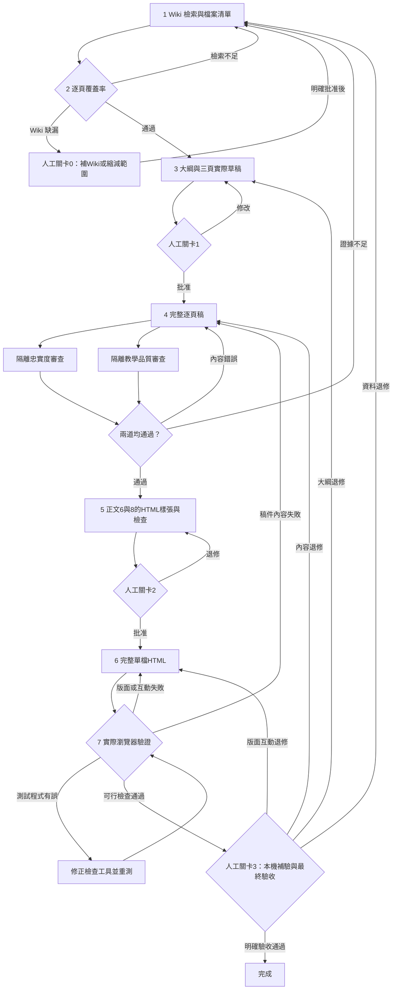

# v3 Graph／Loop：實際使用的流程

此版本對應 `records/runs/attention-v3-001/`。AI 負責檢索、整理與呼叫工具；Python 負責檔案守門、HTML 轉換與瀏覽器檢查。這是 AI 配合腳本執行的工作流程，不是可無人監督重跑所有節點的 LLM API 服務。舊 `workflow/README.md` 是前版歷史。

| 節點 | 通過依據／實際產物 | 不通過時 |
|---|---|---|
| 1 | Wiki 清單、涵蓋主題、雜湊；知識限於 Wiki | 重新檢索，不從記憶補學術主張 |
| 2 | 每頁主張與 Wiki 對照，起源、程序、結果及限制均有依據 | 確實缺漏時停關卡0；Wiki 修改需明確授權 |
| 3 | 14頁正文大綱、逐頁問題、訊息、版型，以及三頁草稿 | 回大綱；必須重新經人工批准 |
| 4 | 凍結逐頁稿，兩個不繼承歷史的獨立審查上下文分別審忠實度／教學品質 | 修稿後重新審查；不得用同上下文角色切換代替 |
| 5 | 正文6與8樣張、可行操作測試 | 修改樣張；停人工關卡2 |
| 6 | `presentation/v3/build_deck.py` 驗證樣張核准雜湊、兩份審查通過且對應當前稿件、Wiki 凍結雜湊，再產生HTML | 檔案或核准不一致即停止；不得自行補核准 |
| 7 | `presentation/v3/test_deck.py`，實際 Chromium／Playwright；報告逐項結果與未驗證項目 | 分類回退；工具誤判亦保留初測、說明並重測 |

審查輸入封存在 `review-packets/v3-manuscript-02/`，不含生成者自評；報告記錄 `fork_turns=none`、輸入雜湊及逐頁結果。審查通過只表示稿件通過，不能代替瀏覽器或真人學習效果驗證。

## Loop 與停止規則

初次產生／檢查不算修正；自動檢查造成的修正最多3輪。一份報告的多個問題可同輪處理，但每輪修正後都要留下結果；不得無限重試。若用盡仍有必要檢查失敗，停止並列錯誤。人工意見按最新需求不計入自動上限，另記新回饋與額度重算，不能改寫舊歷史。

首次完整交付循環實際用了2輪：第1輪補逐頁稿缺少的完整書目，兩道隔離審查重跑通過；第2輪修正封面捲動測試目標，HTML未變，完整瀏覽器套件重跑通過。當時剩餘1輪。沒有為湊輪數而製造問題。

後續人工回饋01要求補原研究及個人結果解讀，按最新人工退修規則另記新循環。動態分支文字也進入凍結稿及兩道審查；建置只接受pass且沒有阻擋問題的報告，未標示問題預設阻擋。測試前先核對無等待審查、HTML雜湊與報告檔不存在，避免測舊產物或覆寫證據。本循環工具修正1輪，剩2輪；617項完整測試通過，詳 `feedback01-handoff.md`。原循環額度與報告不改寫。

在人工關卡一律停下。工具受限則寫「未驗證」，不能把未驗證改成通過。本次停在關卡3，直接本機開檔待使用者補驗。

## 紀錄結構與可重現範圍

- `state.json`：當前節點、核准訊息、輸入雜湊、修正額度及未驗證項目。
- `events.jsonl`：實際執行事件；`versions.md` 對照事件與 Git commit，避免提交內容自引尚未存在的 commit。
- `fidelity-*.json`、`teaching-*.json/.md`：兩道獨立審查的初審及重審。
- `full-browser-01.json`：初測，保留失敗；`full-issue-02.json`：診斷、修正及重測；`full-browser-02.json`：最新逐項結果與截圖路徑。
- `final-consistency.json`：稿件、Wiki、舊版及批准樣張的保留檢查。

可在專案根目錄執行 `python presentation/v3/build_deck.py` 重建，再執行 `python presentation/v3/test_deck.py --report YOUR-NEW-REPORT.json`。需 Python Playwright 與 `/usr/bin/chromium`；新測試使用新報告名，勿覆寫既有證據。這兩個命令不會替使用者作人工核准，也不會自動呼叫隔離審查 AI。
